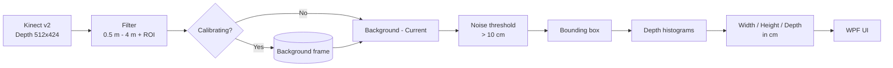

# Kinect Object Dimensions

> Measure the **width, height and depth** of a package in real time with a **Kinect v2** depth camera and a small WPF desktop app.


---

## Contents

- [How it works](#how-it-works)
- [Features](#features)
- [Requirements](#requirements)
- [Getting started](#getting-started)
- [Usage](#usage)
- [Project structure](#project-structure)
- [Measurement algorithm](#measurement-algorithm)
- [Tuning parameters](#tuning-parameters)
- [Known limitations](#known-limitations)
- [Architecture](#architecture)

---

## How it works

The Kinect is mounted **above a flat surface, facing down**. The app first records the empty surface as a **background (calibration) frame**. When you place a package on the surface, every depth pixel that is closer to the camera than the background belongs to the object. From those pixels the app finds the package's outline and its height above the surface, then turns pixels into centimetres using the camera's field of view.



## Features

- Live depth streaming from the Kinect v2 sensor (about 30 fps)
- One-click or continuous background calibration
- Adjustable **region of interest (ROI)** with a visual overlay
- Bounding box drawn around the detected object
- Real-time display of **Width**, **Height** and **Depth** in centimetres
- Sensor availability shown in the status bar

## Requirements

| Component | Version |
|---|---|
| OS | Windows 8 / 8.1 / 10 / 11 (64-bit) |
| Sensor | Kinect for Windows v2 (or Kinect for Xbox One + adapter) |
| USB | USB 3.0 port |
| SDK | [Kinect for Windows SDK 2.0](https://www.microsoft.com/en-us/download/details.aspx?id=44561) |
| Runtime | .NET Framework 4.5.1 or later |
| IDE | Visual Studio 2013 or later, with the .NET desktop workload |

## Getting started

```powershell
git clone https://github.com/RadwanIbrahim/kinect-Object-Dimensions.git
cd kinect-Object-Dimensions
start PackageDimensions.sln
```

1. Install the **Kinect for Windows SDK 2.0** so that `Microsoft.Kinect` (v2.0.0.0) can be resolved.
2. Open `PackageDimensions.sln` in Visual Studio.
3. Build and run (`F5`). The status bar shows **Running** when the sensor is connected.

> **Note:** The project is set up to sign ClickOnce manifests with `PackageDimensions_TemporaryKey.pfx`, and that file isn't in the repository. If the build fails on signing, open **Project Properties → Signing** and clear **Sign the ClickOnce manifests**.

## Usage

1. **Mount** the Kinect above the measuring surface, looking straight down, between **0.5 m and 4 m** away.
2. **Adjust the ROI** with the *Width* and *Height* sliders so that the white rectangle covers only the measuring surface.
3. **Calibrate** with the surface empty:
   - Click **Calibrate** to capture a single background frame, or
   - Tick the **Calibrate** check box to capture continuously, then untick it.
4. **Place the package** inside the ROI. A bounding box appears and the dimensions update live.

| Output | Meaning |
|---|---|
| **Width** | Horizontal size of the top face (camera X axis) |
| **Height** | Vertical size of the top face (camera Y axis) |
| **Depth** | Height of the package above the surface (camera Z axis) |

## Project structure

```
kinect-Object-Dimensions/
├── PackageDimensions.sln            # Visual Studio solution
├── README.md
├── docs/
│   └── ARCHITECTURE.md              # Solution architecture
└── PackageDimensions/
    ├── App.xaml / App.xaml.cs       # WPF application entry point
    ├── App.config                   # Runtime configuration
    ├── MainWindow.xaml              # UI layout (views, sliders, labels)
    ├── MainWindow.xaml.cs           # Sensor handling + measurement pipeline
    ├── PackageDimensions.csproj     # Project file (unsafe code enabled)
    └── Properties/                  # Assembly info, resources, settings
```

## Measurement algorithm

All of the processing happens in `MainWindow.ProcessDepthFrameData`:

| Step | Description |
|---|---|
| 1. Filter | Discard pixels outside 500–4000 mm or outside the centred ROI |
| 2. Calibrate | Store the filtered frame as the background |
| 3. Subtract | `Difference = Background − Current`; keep values > 100 mm |
| 4. Bounding box | Scan rows and columns from each edge; the first line with > 10 object pixels marks an edge |
| 5. Histograms | Count the height differences and the raw distances inside the box |
| 6. Convert | Turn pixel spans into cm using the field of view |

The conversion uses the Kinect v2 depth camera's field of view, which is **70.6° × 60°** at **512 × 424** pixels:

$$
W = \frac{2\,D\,\tan(35.3^\circ)\,(x_R - x_L)}{512}, \qquad
H = \frac{2\,D\,\tan(30^\circ)\,(y_B - y_T)}{424}
$$

In these formulas, $D$ is the most frequent camera-to-surface distance inside the bounding box. The package **depth** is the largest height difference that appears in more than 4 pixels. All values are divided by 10 to convert mm to cm.

## Tuning parameters

These values are hard-coded in `MainWindow.xaml.cs`:

| Value | Purpose |
|---|---|
| `500` / `4000` mm | Valid depth working range |
| `100` mm | Minimum height for a pixel to count as part of the object (noise filter) |
| `10` pixels | Minimum object pixels per row or column to mark a bounding box edge |
| `4` pixels | Minimum histogram count for the depth value |
| `35.3°` / `30°` | Half of the horizontal and vertical field of view |

## Known limitations

- Objects **shorter than 10 cm** aren't detected because of the noise threshold.
- Only **one object** is measured at a time, and it must be roughly aligned with the camera axes.
- Accuracy depends on mounting the camera perpendicular to the surface.
- All processing runs on the UI thread.
- The ROI width slider starts at `521`, which is above its maximum of `512`, so WPF clamps it to `512`.

## Architecture

See [docs/ARCHITECTURE.md](docs/ARCHITECTURE.md) for components, data flow and design decisions.

