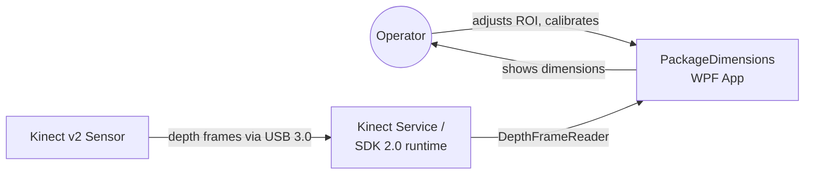
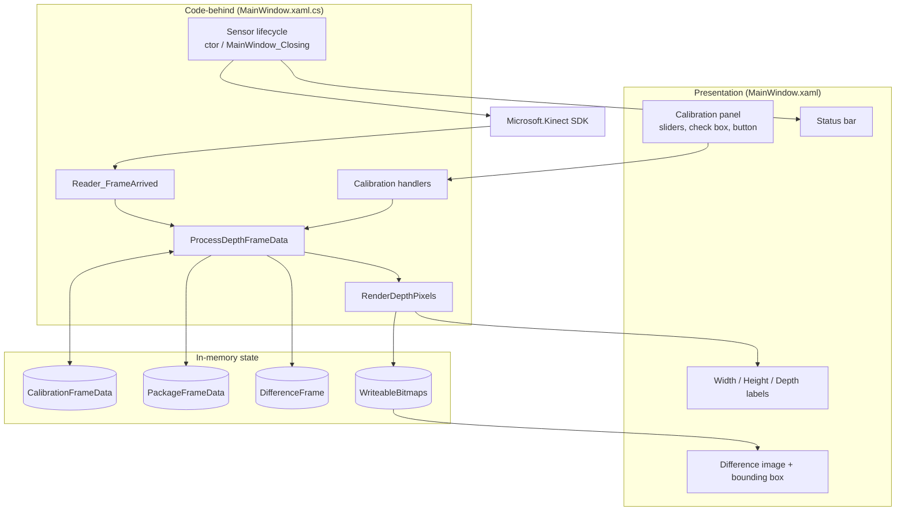
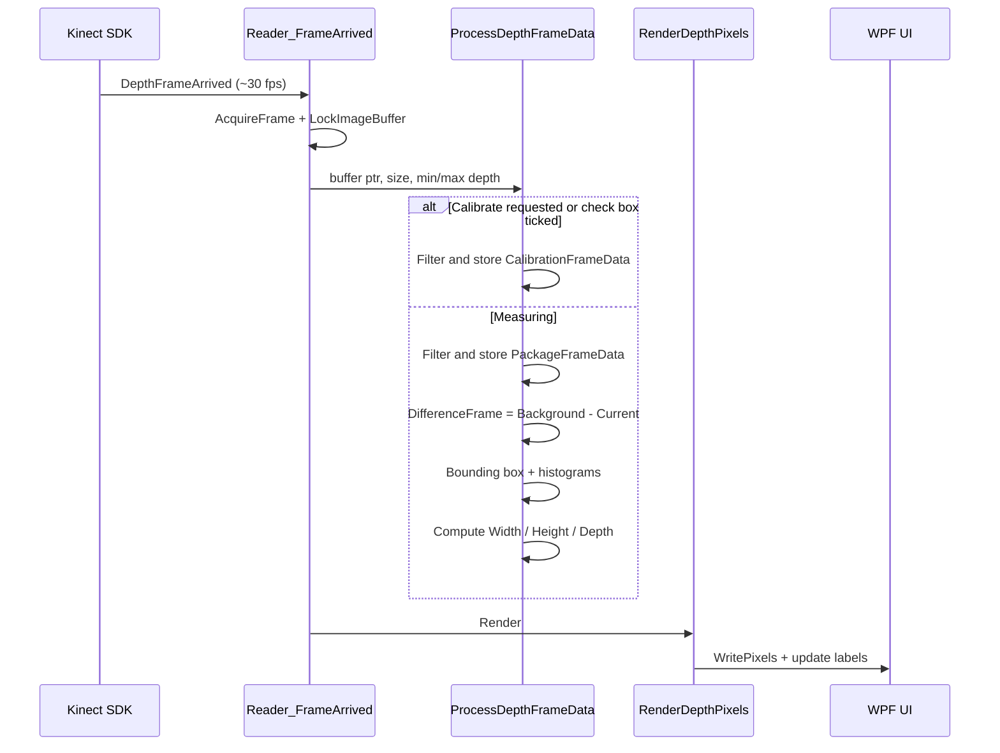
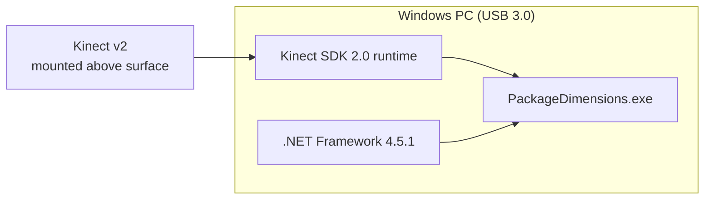

# Solution Architecture: Kinect Object Dimensions

## 1. Overview

**PackageDimensions** is a single-window WPF desktop app. It estimates the size of a box-shaped object (a package) using a **Microsoft Kinect v2** time-of-flight depth sensor. It uses **background subtraction** on depth data: an empty-scene frame is compared with the live frame to isolate the object. The app then converts the object's pixel footprint and height into centimetres.

| Aspect | Choice |
|---|---|
| Type | Desktop application (single process) |
| UI framework | WPF (.NET Framework 4.5.1) |
| Sensor API | Kinect for Windows SDK 2.0 (`Microsoft.Kinect`) |
| Language | C# with `unsafe` code for direct buffer access |
| Pattern | Code-behind, with the window acting as its own view model (`INotifyPropertyChanged`) |
| Persistence | None (calibration is kept in memory only) |

## 2. Context

## 3. Component view

| Component | Responsibility |
|---|---|
| `App` | WPF entry point; opens `MainWindow` (`StartupUri`). |
| Sensor lifecycle | Gets the default sensor, opens the `DepthFrameReader`, allocates buffers and bitmaps, and releases them on close. |
| `Reader_FrameArrived` | Gets each depth frame, locks the native buffer, checks its size and passes it to the processor. |
| `ProcessDepthFrameData` | The measurement pipeline: filtering, calibration, subtraction, bounding box, histograms and unit conversion. |
| `RenderDepthPixels` | Writes the grey-scale buffers to the `WriteableBitmap`s and updates the dimension labels. |
| Calibration handlers | Update the ROI size and its overlay, and request a calibration frame. |
| `Sensor_IsAvailableChanged` | Shows the sensor's connection state in the status bar. |

## 4. Runtime flow

Everything runs on the **WPF dispatcher (UI) thread**. The Kinect SDK raises `FrameArrived` on the thread that created the reader.

## 5. Measurement pipeline

### 5.1 Data model

| Buffer | Type | Size | Content |
|---|---|---|---|
| `CalibrationFrameData` | `ushort[]` | 512 × 424 | Filtered background depth (mm) |
| `PackageFrameData` | `ushort[]` | 512 × 424 | Filtered live depth (mm) |
| `DifferenceFrame` | `ushort[]` | 512 × 424 | Height above the background (mm) |
| `*depthPixels` | `byte[]` | 512 × 424 | Gray8 display buffers |

### 5.2 Steps

1. **ROI and range filter.** Pixels outside the centred `CalibrationWidth × CalibrationHeight` rectangle, or outside **500–4000 mm**, are set to `0`.
2. **Calibration.** When `IsCalibrate` is set (by the button) or the check box is ticked, the filtered frame becomes the background. `IsCalibrate` then resets to `false`.
3. **Background subtraction.** `Difference = Background − Current`. Values ≤ 100 mm count as noise and are set to `0`.
4. **Bounding box detection.** Rows are scanned from the top and bottom at the same time, and columns from the left and right. The first line with **more than 10** non-zero difference pixels becomes an edge (`TopY`, `DownY`, `LeftX`, `RightX`).
5. **Overlay.** The bounding box is drawn in white (255) on the difference image.
6. **Statistics:**
   - `DifferentDepthWeight` is a histogram of the height differences in the box. **Package depth** is the largest value with a count above 4.
   - `DepthWeight` is a histogram of the non-zero distances in the box. Its mode, **D**, is the distance from the camera to the top face.
7. **Pixel-to-metric conversion** uses a pinhole model with the Kinect v2 depth field of view (70.6° × 60°):

$$
\text{Width} = \frac{2D\tan(35.3^\circ)\cdot \Delta x}{512}, \quad
\text{Height} = \frac{2D\tan(30^\circ)\cdot \Delta y}{424}
$$

The results are divided by 10 to convert mm to cm.

## 6. Design decisions

| Decision | Rationale | Trade-off |
|---|---|---|
| Background subtraction rather than plane fitting | Simple, fast, and needs no geometry setup | Assumes the camera and surface don't move after calibration |
| `unsafe` pointer access to the depth buffer | Avoids copying 217k pixels per frame | Needs `AllowUnsafeBlocks` |
| Histogram mode for distance | Robust to edge noise and flying pixels | Integer-mm buckets |
| Edge scan with a 10-pixel threshold | Cheap rejection of isolated noise | Assumes one object aligned with the axes |
| Window acts as its own view model | Minimal code for a prototype | Logic is tightly coupled to the UI |
| Processing on the UI thread | Simple, with no synchronisation needed | Can reduce UI responsiveness |

## 7. Deployment

- The project is set up for ClickOnce publishing (`PublishWizardCompleted`), with signed manifests.
- The Debug and Release configurations exist for `AnyCPU`, `x86` and `x64`.

## 8. Extension points

These would be natural next steps; none of them is implemented yet:

- Move the pipeline into a separate, testable `DimensionCalculator` class (MVVM).
- Process frames on a background task and marshal only the results to the UI.
- Make the thresholds configurable through `App.config` or the UI.
- Use a minimum-area rotated rectangle to support packages that aren't aligned with the axes.
- Save the calibration between sessions.
- Average results over several frames for more stable readings.
